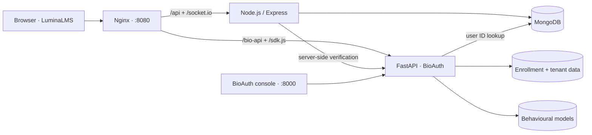
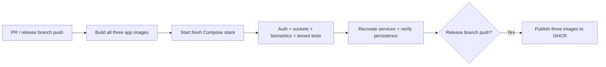

<div align="center">

# BioAuth · Continuous Behavioural Authentication

### Your password opens the door. Your typing helps verify who stays.

A behavioural biometrics platform paired with **LuminaLMS**: live assessments, coding practice, and continuous identity signals in one project.

[](https://github.com/vijay-1806/Biometrics-Authentication/actions/workflows/ci-cd.yml)


[Quick start](#quick-start) · [How it works](#how-it-works) · [CI / CD](#ci--cd) · [Documentation](#documentation)

</div>

---

## The project

BioAuth explores continuous authentication through keystroke timing and behaviour during a learning session. A React LMS collects interaction signals; a Python service builds per-user behavioural models and returns trust scores. Teachers can follow live assessments and review risk events alongside assessment results.

This repository contains both the **learning application** and the **Biometrics-as-a-Service API**, including its management console and embeddable JavaScript SDK.

| Learning experience | Behavioural authentication |
| --- | --- |
| Student, teacher, and administrator dashboards | Keystroke enrollment and continuous verification |
| Courses, coding assignments, and timed quizzes | StandardScaler + Isolation Forest models |
| Monaco coding editor and test-case execution | Trust scoring and adaptive retraining |
| Live assessment sessions with Socket.IO | Tenant workspaces, scoped keys, and usage telemetry |
| Results, performance views, and proctoring alerts | SDK delivery, model caching, and signed webhooks |

## Quick start

**Requirements:** Git and Docker with Docker Compose v2.20 or newer. Start Docker Desktop or your Docker Engine first. Internet access is needed for the first build.

Clone the completed release branch:

```bash
git clone --branch release/v1.2 --single-branch https://github.com/vijay-1806/Biometrics-Authentication.git
cd Biometrics-Authentication
```

**Start the whole project with one command:**

```bash
docker compose up --build -d --wait
```

No local Node.js, Python, MongoDB, manual database import, or environment-file setup is required. The first build downloads dependencies and can take a few minutes.

| Open | Address |
| --- | --- |
| LuminaLMS | [http://localhost:8080](http://localhost:8080) |
| BioAuth management console | [http://localhost:8000](http://localhost:8000) |
| Interactive ML API documentation | [http://localhost:8000/docs](http://localhost:8000/docs) |
| SDK integration demo | [http://localhost:8000/demo](http://localhost:8000/demo) |
| LMS readiness | [http://localhost:8080/api/health](http://localhost:8080/api/health) |
| ML health through the app | [http://localhost:8080/bio-api/v1/system/health](http://localhost:8080/bio-api/v1/system/health) |

Create a student account in the LMS. Each installation starts with an empty learning database and fresh biometric storage; repository exports, personal profiles, and trained models are excluded from Docker images.

The BioAuth console is a separate application with its own accounts. Its existing bootstrap logins are `admin@bioauth.service` and `vijay@bioauth.io`, both with password `BioAuth@2026!`. These are local demonstration credentials. Change them in the console before exposing the service. The LMS integration uses the existing development key `bio_live_default_lms_key`.

### Create a teacher or LMS administrator

Staff access is provisioned explicitly; public signup creates students. Run this from a Bash-compatible terminal, replacing the example account details:

```bash
read -rsp "New account password (12+ characters): " ACCOUNT_PASSWORD
echo
export ACCOUNT_PASSWORD
docker compose exec -e ACCOUNT_NAME="Demo Teacher" -e ACCOUNT_EMAIL="teacher@example.com" -e ACCOUNT_PASSWORD -e ACCOUNT_ROLE="teacher" backend node scripts/create-account.js
unset ACCOUNT_PASSWORD
```

Use `ACCOUNT_ROLE="admin"` for an LMS administrator. The script hashes passwords through the existing user model and refuses to overwrite an account.

### Everyday commands

```bash
docker compose ps                 # Service status
docker compose logs -f            # Stream logs; Ctrl+C stops log streaming
docker compose down               # Stop containers; keep all saved data
docker compose up -d --wait       # Start again
docker compose up --build -d --wait # Rebuild after pulling source changes
```

To reset the installation, `docker compose down --volumes` permanently removes the Compose database, biometric data, trained models, and generated JWT key.

### Optional configuration

Copy `.env.example` to `.env` only if you want to change defaults:

| Variable | Default | Purpose |
| --- | --- | --- |
| `APP_PORT` | `8080` | Host port for the LMS |
| `ML_PORT` | `8000` | Host port for the BioAuth console/API |
| `JWT_SECRET` | Generated automatically | Optional signing key, at least 32 characters |

Containers generate a random JWT signing key on first startup and keep it in the `backend-runtime` volume. Changing it invalidates existing LMS tokens.

Both published ports bind to `127.0.0.1`; the database and Node API stay inside Docker's network. A public deployment needs a hosting target, HTTPS, deliberate access controls, and replacement of the demonstration accounts and integration key. See [security](docs/security.md) and [deployment notes](docs/deployment.md).

## How it works



1. **Sign in:** the LMS issues a JWT and opens authenticated assessment sockets.
2. **Enroll:** typing samples build a baseline for the learner.
3. **Verify:** the SDK submits new samples while the learner works.
4. **Score:** the ML service extracts timing features and compares them with the user's model.
5. **Review:** dashboards surface trust signals and assessment activity.

The service uses provisional enrollment after **10 samples** and full enrollment after **20 samples**. Trust scores are behavioural signals, not proof of identity; see the [limitations](docs/limitations.md).

Docker Compose waits for dependencies to report healthy. Named volumes preserve MongoDB, ML data (including its encryption key), models, and the LMS JWT key across restarts and container recreation. The ML service intentionally runs one worker because its JSON stores and cache are local to the process.

## CI / CD

The [GitHub Actions workflow](.github/workflows/ci-cd.yml) runs for pull requests and pushes targeting **`release/v1.2`**. A manual run is also available once GitHub exposes the workflow on the default branch.



The pipeline checks SPA routes, API readiness, signup/login, student role enforcement, authenticated WebSockets, SDK delivery, biometric enrollment, customer workspace access, and persistence after recreating services. Failed runs upload Compose logs for diagnosis.

Successful release-branch runs publish these **Linux amd64** images:

- `ghcr.io/vijay-1806/biometrics-authentication-frontend`
- `ghcr.io/vijay-1806/biometrics-authentication-backend`
- `ghcr.io/vijay-1806/biometrics-authentication-ml`

Each image gets `1.2` and `sha-<full-commit-sha>` tags. Publishing uses GitHub's built-in `GITHUB_TOKEN`; no Docker Hub credentials are needed. Pull requests cannot publish. Actions are pinned to commit SHAs, with Dependabot configured to propose updates.

This is continuous delivery to the container registry. Automatic deployment to a running server is not configured because no hosting destination has been selected.

### Run published images

After the first successful publish, set each GHCR package to **public** if you want anonymous pulls. Otherwise authenticate with `docker login ghcr.io` using an account/token with package read access.

From a clone of this branch:

```bash
docker compose -f docker-compose.yml -f docker-compose.registry.yml up -d --no-build --pull always --wait
```

For a reproducible release or rollback, set `IMAGE_TAG=sha-<full-commit-sha>` in `.env` so all three services use the same verified revision. Source builds remain available on Docker-supported architectures; published images currently target Linux amd64.

## Develop without Docker

Install Node.js 22, Python 3.11, and MongoDB 8. Start MongoDB locally at `mongodb://localhost:27017/lms_demo`.

```bash
npm ci
npm ci --prefix backend
npm ci --prefix frontend --legacy-peer-deps
python -m venv .venv
```

Activate the virtual environment (`source .venv/bin/activate` on Linux/macOS, `.venv\Scripts\Activate.ps1` in PowerShell), then:

```bash
python -m pip install -r behavioral-auth-ml-service/backend/requirements.txt
npm run dev
```

The frontend runs at `http://localhost:5173`, the Node API at `:5000`, and BioAuth at `:8000`. Vite proxies the API, SDK, biometrics, and WebSocket routes. The Docker setup serves a production Vite build through Nginx.

### Run the integration checks

Against a fresh Docker stack, with Node.js 22 installed:

```bash
npm ci --prefix frontend --legacy-peer-deps
node scripts/smoke-test.cjs
docker compose exec -T ml python behavioral-auth-ml-service/backend/test_saas_platform.py
docker compose up -d --force-recreate --wait backend ml frontend
node scripts/smoke-test.cjs --persistence
```

The smoke test creates a temporary learner and enrollment sample in that installation. Run it on a development/test stack.

## Repository map

```text
.github/                         CI/CD and dependency-update configuration
backend/                         Express API, Socket.IO, Mongoose models
frontend/                        React LMS and behavioural SDK integration
behavioral-auth-ml-service/
  backend/                       FastAPI, feature extraction, models, tenants
  frontend/                      BioAuth console and SDK demo
docker/                          Nginx configuration and backend startup
docs/                            Architecture, security, deployment, and demo guides
scripts/                         Development helpers and integration smoke test
docker-compose.yml               Complete source-build stack
docker-compose.registry.yml      Optional published-image overlay
```

## Troubleshooting

| Symptom | What to check |
| --- | --- |
| Cannot connect to Docker | Start Docker Desktop/Engine and ensure your user can access it. |
| Port 8080 or 8000 is occupied | Change `APP_PORT` or `ML_PORT` in `.env`, then rerun Compose. |
| A service is unhealthy | Run `docker compose ps` and `docker compose logs <service>`. |
| No existing courses or trained users | A fresh container installation starts empty. Create accounts and enroll new profiles. |
| Teacher signup is unavailable | Provision the account with the explicit staff command above. |
| GHCR pull is denied | Make the three packages public or log in with package read permission. |
| Behaviour score is unavailable | Complete enrollment and inspect `docker compose logs ml backend`. |

## Documentation

- [Architecture](docs/architecture.md)
- [Behavioural authentication](docs/behavioural-authentication.md)
- [Deployment and pipeline operations](docs/deployment.md)
- [Security](docs/security.md)
- [Limitations](docs/limitations.md)
- [Demo walkthrough](docs/demo_script.md)
- [Project viva questions](docs/viva_questions.md)

Built by [Vijay](https://github.com/vijay-1806) · Release branch: [`release/v1.2`](https://github.com/vijay-1806/Biometrics-Authentication/tree/release/v1.2)
