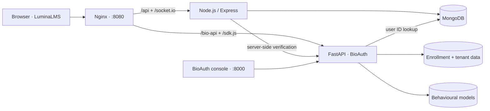
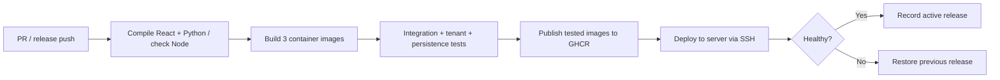

<div align="center">

# BioAuth · Continuous Behavioural Authentication

### Your password opens the door. Your typing helps verify who stays.

A behavioural biometrics platform paired with **LuminaLMS**: live assessments, coding practice, and continuous identity signals in one project.

[](https://github.com/vijay-1806/Biometrics-Authentication/actions/workflows/ci-cd.yml)


[Quick start](#quick-start) · [How it works](#how-it-works) · [CI / CD](#ci--cd) · [Documentation](#documentation)

</div>

---

## The project

BioAuth explores continuous authentication through keystroke timing and behaviour during a learning session. A React LMS collects interaction signals; a Python service builds per-user behavioural models and returns trust scores. Teachers can follow live assessments and review risk events alongside assessment results.

This repository contains both the **learning application** and the **Biometrics-as-a-Service API**, including its management console and embeddable JavaScript SDK.

| Learning experience | Behavioural authentication |
| --- | --- |
| Student, teacher, and administrator dashboards | Keystroke enrollment and continuous verification |
| Courses, coding assignments, and timed quizzes | StandardScaler + Isolation Forest models |
| Monaco coding editor and test-case execution | Trust scoring and adaptive retraining |
| Live assessment sessions with Socket.IO | Tenant workspaces, scoped keys, and usage telemetry |
| Results, performance views, and proctoring alerts | SDK delivery, model caching, and signed webhooks |

## Quick start

**Requirements:** Git and Docker with Docker Compose v2.20 or newer. Start Docker Desktop or your Docker Engine first. Internet access is needed for the first build.

Clone the main branch:

```bash
git clone --branch main --single-branch https://github.com/vijay-1806/Biometrics-Authentication.git
cd Biometrics-Authentication
```

**Start the whole project with one command:**

```bash
docker compose up
```

No local Node.js, Python, MongoDB, manual database import, or environment-file setup is required. Compose builds the current source (using cached layers on later starts), starts MongoDB 7, and automatically installs the saved demo accounts, courses, assignments, quizzes, and trained student models. The first build can take a few minutes. Keep the terminal open; Ctrl+C stops the stack. For background operation, use `docker compose up -d --wait`. Your user needs Docker access; use `sudo docker compose up` if your Linux Docker socket requires it.

| Open | Address |
| --- | --- |
| LuminaLMS | [http://localhost:8080](http://localhost:8080) |
| BioAuth management console | [http://localhost:8000](http://localhost:8000) |
| Interactive ML API documentation | [http://localhost:8000/docs](http://localhost:8000/docs) |
| SDK integration demo | [http://localhost:8000/demo](http://localhost:8000/demo) |
| LMS readiness | [http://localhost:8080/api/health](http://localhost:8080/api/health) |
| ML health through the app | [http://localhost:8080/bio-api/v1/system/health](http://localhost:8080/bio-api/v1/system/health) |

### Saved demo accounts and models

The first startup restores the 3 saved courses, 2 assignments, 3 quizzes, their linked LMS records, and the trained Vijay, Ragavan, and Sarvanth biometric models. Original account IDs and course enrollments are retained. Restarts preserve changed passwords, course edits, and retrained models.

**LMS — http://localhost:8080**

| Email | Password | Role |
| --- | --- | --- |
| `admin@gmail.com` | `LmsAdmin@2026!` | Administrator |
| `teacher@gmail.com` | `password123` | Teacher, with the saved Git and Python courses |
| `teacher-01@gmail.com` | `password123` | Teacher, with the saved NS course |
| `student@gmail.com` | `password123` | Legacy teacher account |
| `vijay@gmail.com` | `123456` | Student, trained profile |
| `sarvanth@gmail.com` | `123456` | Student, trained profile |
| `ragavan@gmail.com` | `123456` | Student, trained profile |

**BioAuth console/API — http://localhost:8000** (separate accounts)

| Email | Password | Access |
| --- | --- | --- |
| `admin@bioauth.service` | `BioAuth@2026!` | Platform administrator |
| `vijay@bioauth.io` | `BioAuth@2026!` | LMS workspace owner |
| `vijay@gmail.com` | `DemoStudent@2026!` | Demo workspace viewer |
| `sarvanth@gmail.com` | `DemoStudent@2026!` | Demo workspace viewer |
| `ragavan@gmail.com` | `DemoStudent@2026!` | Demo workspace viewer |

The LMS SDK uses the development key `bio_live_default_lms_key`. These are local demonstration credentials. Change them before exposing the service. Existing accounts with changed passwords are preserved. A previously imported LMS admin using the exact archived password hash is assigned the documented demo password once during bootstrap.

### Create a teacher or LMS administrator

Staff access is provisioned explicitly; public signup creates students. Run this from a Bash-compatible terminal, replacing the example account details:

```bash
read -rsp "New account password (12+ characters): " ACCOUNT_PASSWORD
echo
export ACCOUNT_PASSWORD
docker compose exec -e ACCOUNT_NAME="Demo Teacher" -e ACCOUNT_EMAIL="teacher@example.com" -e ACCOUNT_PASSWORD -e ACCOUNT_ROLE="teacher" backend node scripts/create-account.js
unset ACCOUNT_PASSWORD
```

Use `ACCOUNT_ROLE="admin"` for an LMS administrator. The script hashes passwords through the existing user model and refuses to overwrite an account.

### Everyday commands

```bash
docker compose ps                 # Service status
docker compose logs -f            # Stream logs; Ctrl+C stops log streaming
docker compose down               # Stop containers; keep all saved data
docker compose up -d --wait       # Start again
docker compose up --build -d --wait # Rebuild after pulling source changes
```

To reset the installation, `docker compose down --volumes` permanently removes the Compose database, biometric data, trained models, and generated JWT key.

### Optional configuration

Copy `.env.example` to `.env` only if you want to change defaults:

| Variable | Default | Purpose |
| --- | --- | --- |
| `APP_PORT` | `8080` | Host port for the LMS |
| `ML_PORT` | `8000` | Host port for the BioAuth console/API |
| `JWT_SECRET` | Generated automatically | Optional signing key, at least 32 characters |

Containers generate a random JWT signing key on first startup and keep it in the `backend-runtime` volume. Changing it invalidates existing LMS tokens.

Both local demo ports bind to `0.0.0.0`, allowing friends on the same LAN to connect. With the stack running, find your Wi-Fi/Ethernet IP using `hostname -I`; your friend opens `http://YOUR_LAN_IP:8080` for LMS or `http://YOUR_LAN_IP:8000` for BioAuth. The host firewall must allow these ports, and the network must allow communication between devices. A private LAN IP does not provide access from another network. Use a trusted network because the demo credentials are documented above. Set `HOST_BIND=127.0.0.1` in `.env` to restrict access to this computer.

The database and Node API stay inside Docker's network. The separate production manifest still binds published ports to localhost. A public deployment needs a hosting target, HTTPS, deliberate access controls, and replacement of the demonstration accounts and integration key. See [security](docs/security.md) and [deployment notes](docs/deployment.md).

## How it works



1. **Sign in:** the LMS issues a JWT and opens authenticated assessment sockets.
2. **Enroll:** typing samples build a baseline for the learner.
3. **Verify:** the SDK submits new samples while the learner works.
4. **Score:** the ML service extracts timing features and compares them with the user's model.
5. **Review:** dashboards surface trust signals and assessment activity.

The service uses provisional enrollment after **10 samples** and full enrollment after **20 samples**. Trust scores are behavioural signals, not proof of identity; see the [limitations](docs/limitations.md).

Docker Compose waits for dependencies to report healthy. Named volumes preserve MongoDB, ML data (including its encryption key), models, and the LMS JWT key across restarts and container recreation. The ML service intentionally runs one worker because its JSON stores and cache are local to the process.

## CI / CD

The [GitHub Actions workflow](.github/workflows/ci-cd.yml) runs for pull requests and pushes targeting **`main` and `release/v1.2`**. Successful `main` pushes publish images and can deploy when configured; release-branch pushes run validation only.



| Stage | What happens |
| --- | --- |
| **Build / compile** | Install locked frontend dependencies, build React, compile Python, check Node syntax, validate Compose/scripts, and run six deployment orchestration tests. |
| **Container build** | Build frontend, backend, and ML images in parallel; pass them onward as workflow artifacts. |
| **Test** | Run those exact images against a fresh MongoDB; test authentication, role enforcement, WebSockets, SDK delivery, enrollment, 11 SaaS/tenant checks, and persistence after container recreation. |
| **Publish** | Push the tested images to GHCR without rebuilding. Create a deployment bundle pinned to image digests. |
| **Deploy** | Transfer the bundle over verified SSH, pull images, update Docker Compose, check health, and restore the previous release on rollout failure. Optionally check the public application URL too. |

Pull requests stop after testing. Main-branch pushes continue to publishing and, once configured, deployment. Failed integration runs upload Compose logs for diagnosis. Production deployment is serialized to prevent overlapping updates.

Images are published under `ghcr.io/vijay-1806/biometrics-authentication-{frontend,backend,ml}`, with `1.2` and `sha-<full-commit-sha>` tags. The deployment bundle uses immutable **digest references**, so production receives the images that passed the tests. Images target Linux amd64.

### Activate automatic deployment

The deploy job is implemented for a Linux server reached over SSH, including AWS EC2 and other VPS providers. **A server has not yet been configured.** Publishing works independently; the deploy job remains skipped until you set the repository variable `DEPLOY_ENABLED=true`.

1. Prepare a Linux amd64 server with Docker Engine, Compose v2.20+, Bash, and `flock`. The SSH user must be able to run Docker.
2. In GitHub repository **Settings → Environments**, create `production` and add secrets `DEPLOY_SSH_KEY` and `DEPLOY_KNOWN_HOSTS` (verified host-key entries).
3. Under **Settings → Secrets and variables → Actions → Variables**, set `DEPLOY_HOST`, `DEPLOY_USER`, optional `DEPLOY_PORT` (default `22`), and optional `DEPLOY_URL` (your HTTPS app URL).
4. Set the repository variable `DEPLOY_ENABLED=true` after the host and secrets are ready, then push to `main`.

The pipeline uses its temporary `GITHUB_TOKEN` to pull even private GHCR images on the server. No Docker Hub credentials or long-lived GHCR token are required. SSH credentials are kept out of release artifacts, and the temporary registry login is removed after deployment.

Releases live at `~/biometrics-authentication/releases/<commit-sha>-<run-id>-<attempt>`. The `current` and `previous` symlinks track successful deployments. Persistent volumes and `~/biometrics-authentication/config.env` survive updates. The supplied ports bind to localhost; point your server's HTTPS reverse proxy at port 8080. See the [deployment guide](docs/deployment.md) for setup, health checks, and rollback.

### Run published images

After the first successful publish, set each GHCR package to **public** if you want anonymous pulls. Otherwise authenticate with `docker login ghcr.io` using an account/token with package read access.

From a clone of this branch:

```bash
docker compose -f docker-compose.yml -f docker-compose.registry.yml up -d --no-build --pull always --wait
```

For a reproducible release or rollback, set `IMAGE_TAG=sha-<full-commit-sha>` in `.env` so all three services use the same verified revision. Source builds remain available on Docker-supported architectures; published images currently target Linux amd64.

## Develop without Docker

Install Node.js 22, Python 3.11, and MongoDB 7. Start MongoDB locally at `mongodb://localhost:27017/lms_demo`.

```bash
npm ci
npm ci --prefix backend
npm ci --prefix frontend --legacy-peer-deps
python -m venv .venv
```

Activate the virtual environment (`source .venv/bin/activate` on Linux/macOS, `.venv\Scripts\Activate.ps1` in PowerShell), then:

```bash
python -m pip install -r behavioral-auth-ml-service/backend/requirements.txt
npm run dev
```

The frontend runs at `http://localhost:5173`, the Node API at `:5000`, and BioAuth at `:8000`. Vite proxies the API, SDK, biometrics, and WebSocket routes. The Docker setup serves a production Vite build through Nginx.

### Run the integration checks

Against a fresh Docker stack, with Node.js 22 installed:

```bash
npm ci --prefix frontend --legacy-peer-deps
node scripts/smoke-test.cjs
node scripts/demo-smoke-test.cjs
docker compose exec -T ml python behavioral-auth-ml-service/backend/test_saas_platform.py
docker compose up -d --force-recreate --wait backend ml frontend
node scripts/smoke-test.cjs --persistence
```

The smoke test creates a temporary learner and enrollment sample in that installation. Run it on a development/test stack.

## Repository map

```text
.github/                         CI/CD and dependency-update configuration
backend/                         Express API, Socket.IO, Mongoose models
frontend/                        React LMS and behavioural SDK integration
behavioral-auth-ml-service/
  backend/                       FastAPI, feature extraction, models, tenants
  frontend/                      BioAuth console and SDK demo
docker/                          Nginx configuration and backend startup
docs/                            Architecture, security, deployment, and demo guides
scripts/                         Development helpers and integration smoke test
docker-compose.yml               One-command demo stack with saved data and models
docker-compose.registry.yml      Optional published-image overlay
docker-compose.deploy.yml        Digest-pinned server deployment manifest
```

## Troubleshooting

| Symptom | What to check |
| --- | --- |
| Cannot connect to Docker | Start Docker Desktop/Engine and ensure your user can access it. |
| Port 8080 or 8000 is occupied | Change `APP_PORT` or `ML_PORT` in `.env`, then rerun Compose. |
| MongoDB logs mention an incompatible kernel | See the [host compatibility notes](docs/deployment.md#configure-the-deployment-server); this also affects Docker hosts. |
| A service is unhealthy | Run `docker compose ps` and `docker compose logs <service>`. |
| No existing courses or trained users | Run `docker compose up` to rebuild the source images and run the automatic demo bootstrap. Inspect `docker compose logs backend ml` if seeding reports an account ID conflict. |
| Teacher signup is unavailable | Provision the account with the explicit staff command above. |
| GHCR pull is denied | Make the three packages public or log in with package read permission. |
| Behaviour score is unavailable | Complete enrollment and inspect `docker compose logs ml backend`. |

## Documentation

- [Architecture](docs/architecture.md)
- [Behavioural authentication](docs/behavioural-authentication.md)
- [Deployment and pipeline operations](docs/deployment.md)
- [Security](docs/security.md)
- [Limitations](docs/limitations.md)
- [Demo walkthrough](docs/demo_script.md)
- [Project viva questions](docs/viva_questions.md)

Built by [Vijay](https://github.com/vijay-1806) · Release branch: [`release/v1.2`](https://github.com/vijay-1806/Biometrics-Authentication/tree/release/v1.2)
